# ChemTrack & WasteTrack v2.0.40 release notes

Changes since v2.0.35. Screenshots show the English interface in the local v2.0.40 build.

## Notifications and navigation

**In-app notifications.** Lab users and administrators can use the header bell and Notifications page to see chemical expiry alerts, incoming bottle transfers, and waste collection appointments. Search or filter by type, store, date, and unread status.

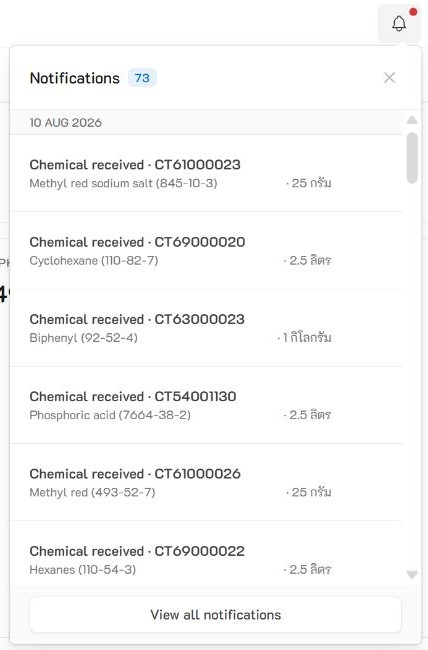

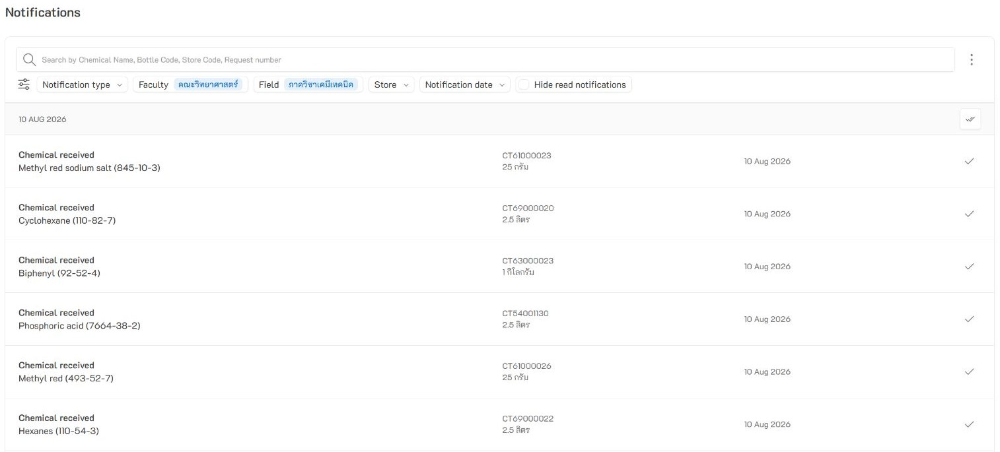

**Keyboard shortcuts for chemical search.** Press **Alt+Enter** to open Global Search, use the arrow keys to move through results, and press **Enter** to view a match.

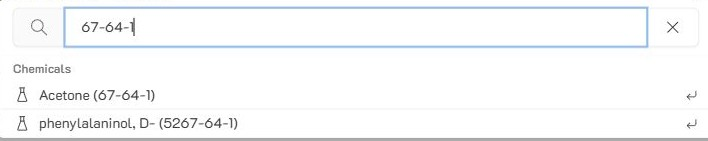

**Improved menus and charts.** Submenus open to the left when space is limited on the right, and charts resize to fit the available space.

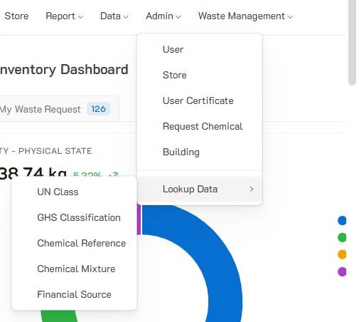

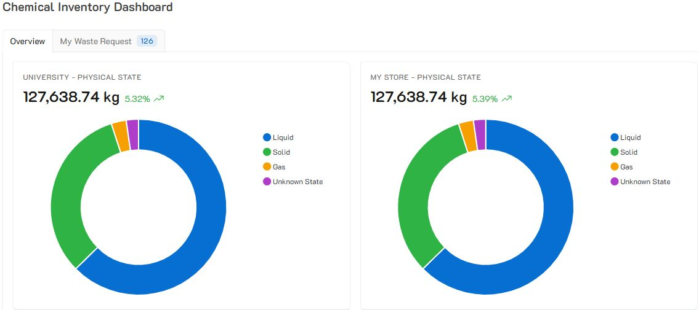

## Chemical inventory and sharing

**Fixed missing bottle codes on printed 1D barcodes.** Select **1D Barcode** in Barcode Configuration to generate the labels.

**Restored sharing with a specific store.** Labs can find chemical inventory shared directly with their store, subject to the configured sharing permissions.

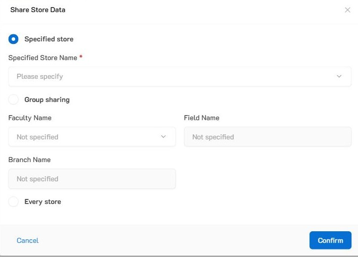
## Waste requests and collection

**Find requests by store or request date.** The dashboard’s **My Waste Request** tab adds both filters alongside the existing status and location filters.

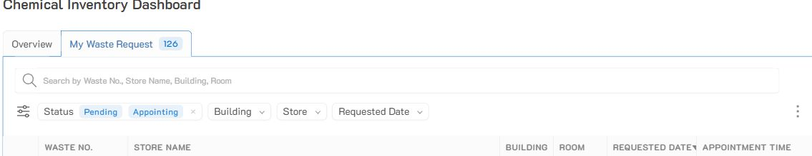

**Waste volumes are limited to 80% of container capacity.** The same limit applies when entering or updating volumes. If one volume in a batch is invalid, the entire batch is rejected. In the example below, a 4 L container allows a current volume of up to 3.2 L.

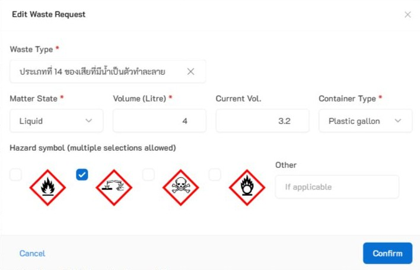

**More consistent disposal pricing.** Each waste type can have one default disposal price. Once a price is assigned, the waste type and quantities used for billing are protected from ordinary edits.

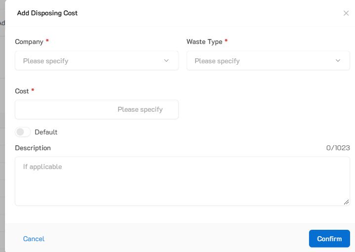

## Reports and Excel exports

**Month-only date selection.** Choose a start and end month by selecting the month and year. This applies to reports such as Bottle Operations, Expense History, Chemical Volume History, and fiscal-year waste reports by building and field.

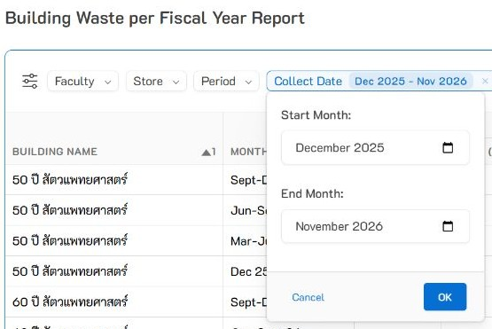

**Improved hazard reporting.** The Current Chemical report can filter by GHS classification group. Current-stock GHS totals exclude bottles removed from inventory.

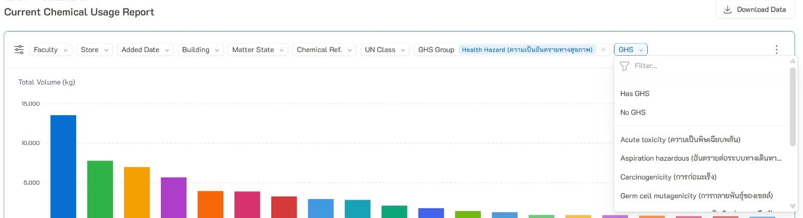

**More complete waste breakdowns.** Fiscal-year reports by building and field now show waste categories **XVI–XX**. The building report includes a category reference, and field totals include records with no field assigned.

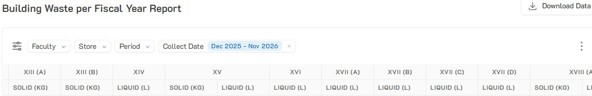

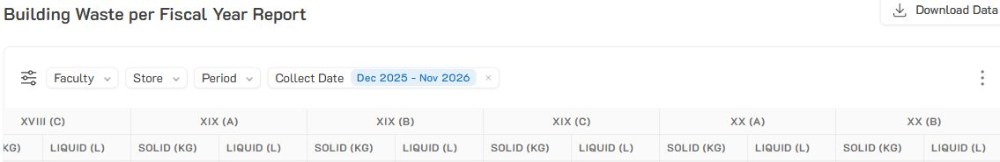

**Room Waste Report.** The doughnut chart shows the percentage of rooms that sent hazardous waste for disposal. Rooms with no matching disposal records appear at zero tons. Store and collection date filters determine which waste records count, and location filters narrow the room list. Select **Show only rooms with waste data** to limit the chart, table, and Excel export to rooms with a positive waste total.

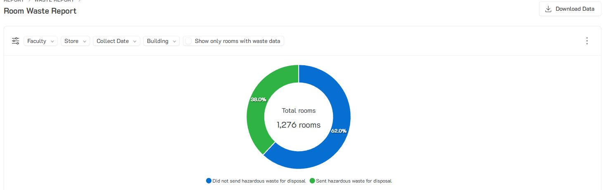

**Clearer totals and Excel exports.** Numbered references link report headers to an explanation of how total volume is calculated. Excel column headers omit the on-screen footnote markers. The top chemical usage report explains that its ranking uses quantities from removed containers.

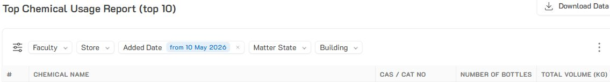
## Report footnote

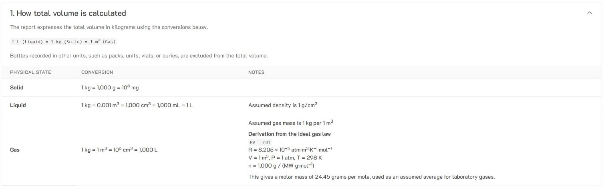

## Other user-facing changes

- **Dashboard links.** A direct link can open the **My Waste Request** tab with a search term already filled in.
- **Access prompts.** When a page requires sign-in, the app returns users to the sign-in screen. Signed-in users who lack permission see an access-denied message.
- **Adding store users.** The add-user form now requires a password of at least six characters.
- **Training status.** The store user permissions list shows the training badge and its date when training has been recorded.
- **Bottle units.** Ordinary bottle edits keep the original unit of measure, protecting the meaning of quantities already recorded for that bottle.
- **Safety data sheets.** Users can download shared SDS files from a store they can access. To attach an SDS to a bottle, use a compatible document from that store or the shared library.
- **Chemical validation.** The most recent editor is recorded when validation evidence is updated. The evidence and the chemical’s validation status are saved together.
- **Waste request details.** Lab users can view details for requests they submitted. Administrative access is available through the waste management workflow.
- **Waste labels.** Once waste identifiers are assigned, ordinary edits preserve both the label numbers and the associated container count.
- **Standard GHS groups.** The Physical, Health, and Environmental Hazard groups used by reports are protected from deletion.
- **GHS report totals.** The report footer counts each eligible container once, even when it appears under multiple hazard classifications.
- **Store and room reporting.** The Store Room report supports building-wide assignments and can include stores without a room assignment when no location filter is selected.
- **Bottle report sorting.** The Current Bottle report starts with the most recently added bottles, and the Depleted Bottle report starts with the most recently removed bottles.
- **Funding details.** The Current Bottle report retains manually entered funding details when there is no linked funding record.
- **Chart readability.** Pie and doughnut charts list categories from largest to smallest. The Chemical Usage History chart uses solid fills.
- **Number formatting.** Counts display as whole numbers. Money fields display two decimal places.
- **Report column alignment.** Headers for counts, quantities, and costs now align to the right above their values, making numeric columns easier to scan.
- **Change Password.** The dialog clears all password fields after a successful change or when you cancel. If the change fails, your entries stay in the dialog so you can correct them and retry.
