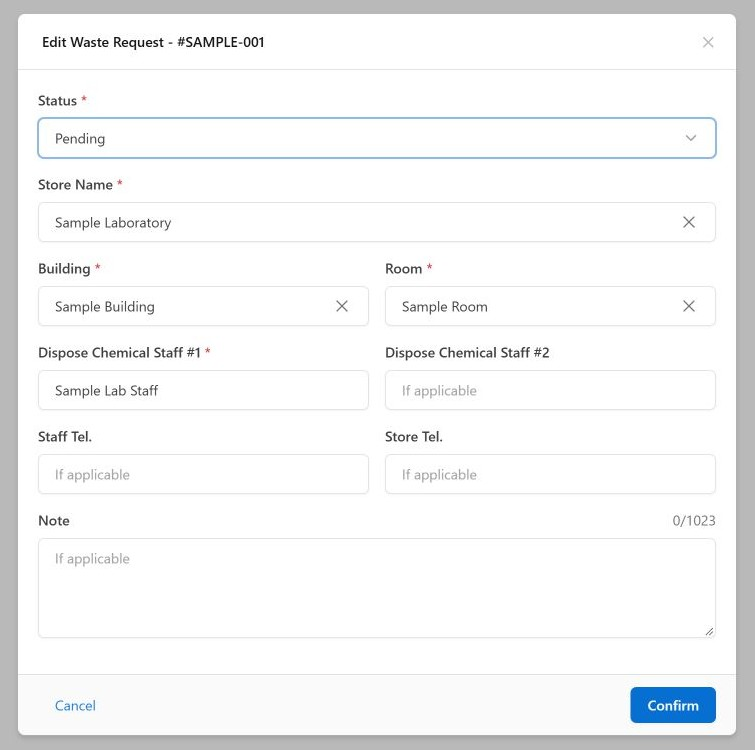
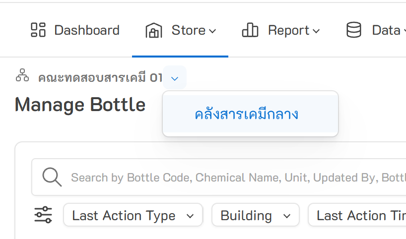
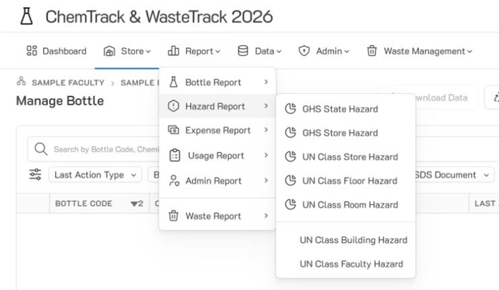

# ChemTrack & WasteTrack v2.0.41 release notes

Changes since v2.0.40. Screenshots show the English interface in the local v2.0.41 build with sample data.

## Waste request administration

**Manual status corrections for administrators.** In **Edit Waste Request**, administrators can now change **Status** to **Creating**, **Pending**, **Appointing**, **Done**, or **Cancelled**. The status selector is hidden for lab users and guests, and existing access restrictions still apply.

Manual corrections change the status without running appointment or collection actions. Use the normal workflow actions when appointment details, waste identifiers, disposal pricing, or collection records need to be processed; setting a status alone does not complete those steps.

**Making an appointment again.** After an administrator returns a request to **Pending**, making a new collection appointment refreshes its existing appointment notification with the new date and marks it unread again.

## Switching between stores

**Cleaner grouping in the store selector.** In the breadcrumb menu on store pages such as **Manage Bottle**, central chemical stores (**คลังสารเคมีกลาง**) now stay together above named stores. A single divider separates the two groups and appears only when both groups are present. Store switching remains subject to the account's configured store scope.

## Other user-facing changes

- **Navigation and report icons.** Menu and report icons use more consistent sizing and clearer strokes. Refreshed icons identify **Admin**, **Waste Management**, **Hazard Report**, and the account menu; navigation icons follow the text color.
- **Training indicators.** User and store-user lists now use a certificate icon when a training date is recorded.

